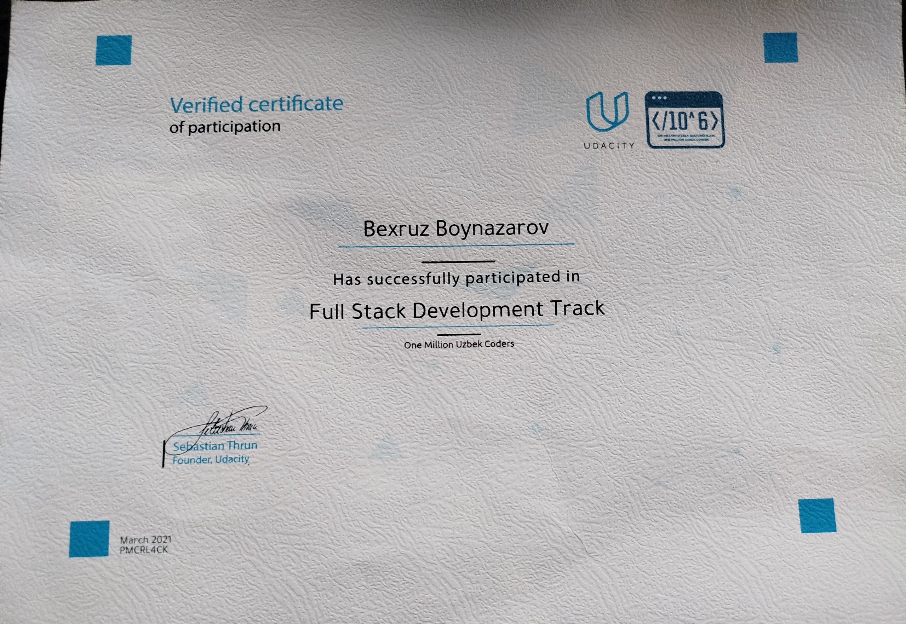

# Bexruz Boynazarov
**Product Engineer · Forward Deployed Engineer (FDE)**  
*Senior Backend & AI Systems Architect*

---

🔗 [Telegram: @bexruzdeveloper](https://t.me/bexruzdeveloper) &nbsp;·&nbsp; 💻 [GitHub: devbexruz](https://github.com/devbexruz) &nbsp;·&nbsp; 🔗 [LinkedIn: bexruzdeveloper](https://linkedin.com/in/bexruzdeveloper) &nbsp;·&nbsp; 🧩 [LeetCode: bexruzdeveloper](https://leetcode.com/bexruzdeveloper) &nbsp;·&nbsp; 📷 [Instagram: @bexruzdeveloper](https://instagram.com/bexruzdeveloper)

---

## Professional Profile

Product-minded Forward Deployed Engineer and Senior Systems Architect with nearly 6 years of experience driving end-to-end software delivery, business process automation, and high-load system architectures. Champion of the modern **Agentic Coding** paradigm — leveraging state-of-the-art AI agents (Claude, Codex) to synthesize code rapidly while maintaining rigorous command over software architecture, code quality, and system design. 

Proven expertise in translating complex client business challenges into production-ready architectures, deploying custom CRM/ERP integrations, and orchestrating advanced AI/LLM workflows (Claude, Amazon Bedrock, OpenAI API, RAG systems). Combines deep, battle-tested Python and PostgreSQL mastery (query optimization, schema modeling, high concurrency) with an entrepreneurial forward-deployed mindset — thriving in direct client collaboration, on-site problem solving, and fast-paced engineering environments.

---

## Core Skills

| Category | Technologies & Competencies |
|---|---|
| **Agentic Engineering & AI** | Claude (Anthropic), OpenAI / Codex, Amazon Bedrock, RAG Systems, Agentic Coding & Prompt Orchestration, HuggingFace, PyTorch, Transformers |
| **System Architecture & Design** | Decoupled Architecture, High-Load Scalability, System Design, SOLID Principles, Code Review & Architecture Governance |
| **Backend Mastery** | FastAPI (Expert), Django, Django REST Framework, SQLAlchemy, Python (Asyncio) |
| **Database & Caching** | PostgreSQL (Deep Optimization, Indexing, Query Tuning, Schema Design), Redis |
| **Business Automation & Integrations** | CRM Logic & Workflow Automation, Webhooks, RESTful & WebSocket APIs, Data Scraping (BeautifulSoup, Selenium) |
| **Cloud & DevOps** | AWS (Amazon Bedrock, EC2, S3), GCP (Foundations), Docker, Docker Compose, Linux, Nginx, Uvicorn |
| **Programming Languages** | Python, SQL, JavaScript/TypeScript, Dart, C# |
| **Frontend & Multiplatform** | Flutter, Dart, React (Working Knowledge), HTML/CSS |

---

## Professional Experience

### Independent Product Engineer & Systems Architect
**2020 — Present** · ~6 years  
*Client-Facing Engagements, Product Delivery & Forward-Deployed Architecture*

Collaborated directly with enterprise clients, business stakeholders, and cross-functional teams to translate domain-specific business goals into resilient, highly automated technical solutions. Controlled end-to-end delivery using modern agentic workflows, governing system architecture and enforcing rigorous code quality while accelerating implementation speed.

---

#### 🔹 NoreStyle Marketplace — High-Load Commerce & Automation Platform

- **Client Alignment & Architecture:** Partnered with business stakeholders to model core business processes (order workflows, role-based access, automated catalog tracking) into a decoupled, scalable architecture.
- **Deep PostgreSQL Optimization:** Analyzed query execution plans, refactored relational schemas, and engineered strategic composite indexing, slashing critical API latency by 40% under sustained database load.
- **Async Workflow Automation:** Architected resilient asynchronous task pipelines using Celery and Redis to handle payment processing, automated transactional emails, and real-time status notifications without blocking the primary event loop.
- **Agentic Code Delivery & SOLID Standards:** Governed code modularity and maintained enterprise-grade SOLID standards across development cycles, overseeing rapid feature development through AI-assisted coding and structured peer reviews.
- **Infrastructure & Containerization:** Containerized the ecosystem with Docker and Docker Compose, enabling reliable staging-to-production pipelines and zero-downtime client deployments.

---

#### 🔹 Math Visual AI Bot — Intelligent LLM Diagnostic & Processing Engine

- **AI/LLM System Architecture:** Built a high-throughput AI-powered backend on FastAPI, integrating Claude and OpenAI models with domain-specific RAG pipelines for contextual interpretation and complex mathematical reasoning.
- **Async Execution & Low Latency:** Engineered fully non-blocking asynchronous request handlers (asyncio), sustaining high concurrent client interactions with minimal server overhead.
- **Data & Visualization Pipelines:** Designed scalable calculation pipelines orchestrating background computation queues and dynamic visual generation (OpenCV, Matplotlib) during traffic spikes.
- **Agent-Assisted Prototyping to Production:** Leveraged AI coding agents for accelerated prototyping and rapid iteration, focusing human engineering effort on core system design, edge-case validation, and performance tuning.

---

#### 🔹 Enterprise Business Automation & Custom Integrations

- **CRM & Workflow Automation:** Built custom CRM logic, lead-routing rules, and automated event triggers via webhooks and REST/WebSocket interfaces to eliminate manual client operational bottlenecks.
- **High-Throughput Web Scraping:** Designed robust, fault-tolerant web scrapers using BeautifulSoup and Selenium to aggregate external market data and feed internal business intelligence pipelines.
- **Cross-Platform Integration:** Delivered unified backend contracts serving mobile clients (Flutter/Dart), third-party partner APIs, and hardware IoT endpoints, ensuring consistent data synchronization and high availability.
- **Forward-Deployed Problem Solving:** Regularly engaged in direct client feedback loops, diagnosing production bottlenecks on-site and delivering tailored software patches rapidly.

---

## Education

**National University of Uzbekistan (O'zMU)**  
*Faculty of Applied Mathematics*

---

## Additional Information

- **Work Format:** Available full-time on-site (5 days/week) and fully prepared for client on-site deployments (Forward Deployed).
- **Communication:** Strong client-facing communication; proficient in technical and business English, native Uzbek.
- **Approach:** Passionate about autonomous AI agents, prompt-driven engineering, and rapid product evolution.

---

## Certifications

**UDACITY (One Million Uzbek Coders) Certificate — Full Stack Development Track**

