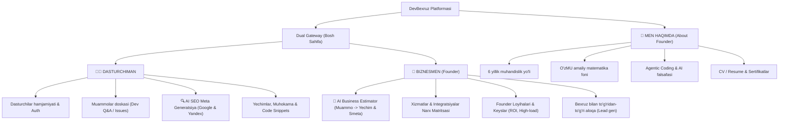
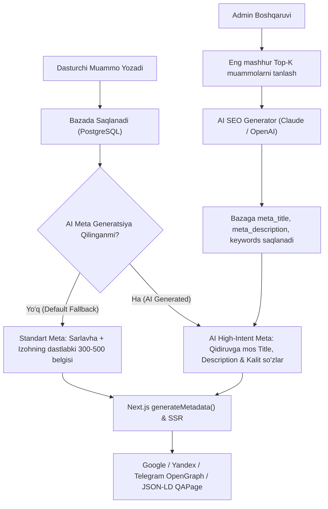
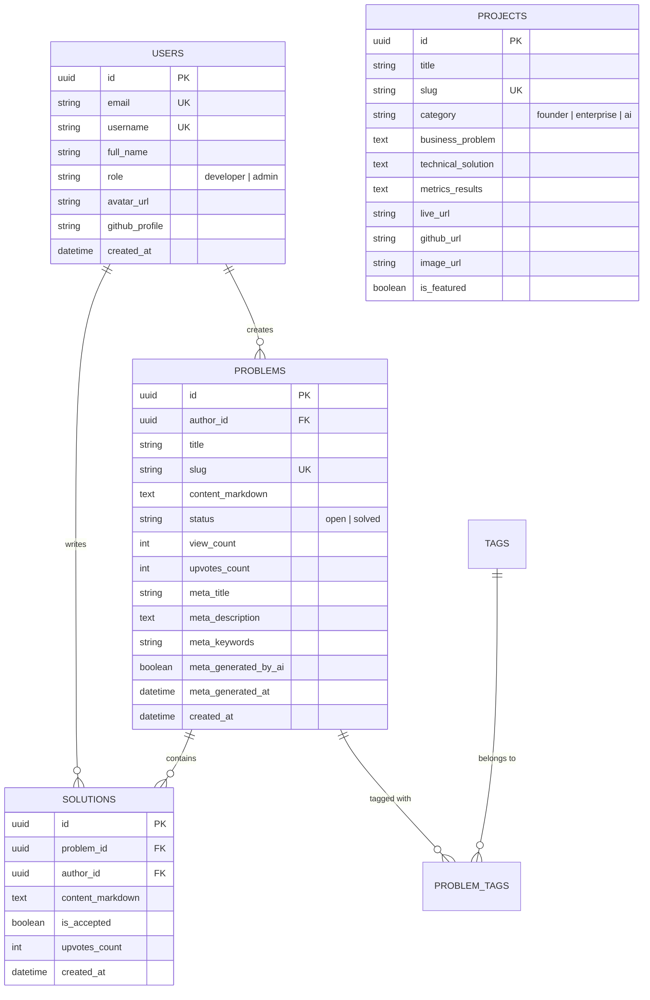

# 🚀 DevBexruz — Platforma Loyiha Rejasi & Arxitekturasi

> **Platforma:** DevBexruz Platform  
> **Asoschi & Bosh Muhandis:** Bexruz Boynazarov (Product Engineer · Systems Architect · Founder)  
> **Asosiy Stack:** Python (FastAPI) + Next.js 15 (App Router, TypeScript, Tailwind CSS) + PostgreSQL

---

## 1. Loyihaning Konsepsiyasi va Maqsadi

Loyiha oddiy statik portfolio emas, balki ikki tomonlama qiymat beruvchi interaktiv **Dev & Business Platforma** hisoblanadi:



---

## 2. Foydalanuvchi Tajribasi (UX/UI) va Sahifalar Tuzilishi

### 🏠 2.1. Asosiy Sahifa (`/`)
- **Hero & Identity Switcher:**
  - Yuqori darajadagi zamonaviy, vizual dinamik blok.
  - Markazda interaktiv kalit (Switch/Tab): **[ 👨‍💻 Dasturchiman ]** va **[ 💼 Biznesmen ]**.
  - Foydalanuvchi tanloviga qarab sahifaning kayfiyati, banneri va kontenti moslashadi.

- **Mode A: "Dasturchiman" Seksiyasi:**
  - **Dev Muammolari Doskasi (Live Feed):** Dasturchilar qoldirgan eng so'nggi va qizg'in muammolar (masalan: *FastAPI async database connection leak*, *PostgreSQL indexing strategy for 10M rows*, *Claude prompt orchestrating issue*).
  - **Muammo qoldirish tugmasi:** Ro'yxatdan o'tgan dasturchilar kod bloki, xatolik logi va teglari bilan savol/muammo yozishi mumkin.
  - **Yechimlar va Upvote:** Bexruz va boshqa tajribali muhandislar tomonidan berilgan eng yaxshi yechimlar reytingi.
  - **SEO-optimizatsiyalangan Sluglar:** Har bir muammo qidiruv tizimlariga mos slug (masalan: `/problems/fastapi-async-connection-leak-500-error`) orqali ochiladi.

- **Mode B: "Biznesmen" Seksiyasi (Founder & AI Estimator):**
  - 🔥 **AI Biznes Yechim & Smeta Generatori (Interactive AI Estimator):**
    - Biznes egasi o'z muammosini erkin shaklda yozadi (masalan: *"Kiyim do'konimiz bor, Telegramda 20 ming mijoz bor, lekin buyurtmalarni qo'lda olamiz, CRM va to'lov integratsiyasi kerak"*).
    - AI Bexruzning xizmatlar matritsasi va narxlari asosida darhol to'liq tijoriy taklif generatsiya qiladi:
      1. Muammoning texnik tahlili va diagnostikasi
      2. Kerakli asosiy servislar va integratsiyalar ro'yxati
      3. Aniq narxlar koridori (masalan: $1,200 - $1,600) va bajarish muddati (2-3 hafta)
      4. Mijoz nimalarni qo'lga kiritadi (Deliverables) va kutilayotgan biznes ROI
      5. *"Ushbu yechimni Bexruz bilan boshlash"* (Telegramga tayyor smeta bilan bitta klikda yuborish).
  - **Xizmatlar va Integratsiyalar Narxlari Katalogi (Transparent Pricing):**
    - Har bir servis (FastAPI Backend, E-Commerce, CRM, Telegram bot, Payme/Click, PostgreSQL optimallashtirish) uchun shaffof narxlar va muddatlar ko'rsatilgan interaktiv jadval.
  - **Founder Loyihalar Vitrinasi (Case Studies):**
    - NoreStyle Marketplace, Math Visual AI, Dangasa Control, DayPlan — biznes muammosi $\rightarrow$ texnik yechim $\rightarrow$ erishilgan raqamlar (40% latency reduction, tejalgan xarajatlar).

### 👤 2.2. "Men Haqimda" Alohida Sahifa (`/about`)
- **Founder & Systems Architect portreti:** Bexruz Boynazarov kim?
- **Ta'lim & Poydevor:** O'zbekiston Milliy Universiteti (O'zMU), Amaliy matematika fakulteti. Matematik modellashtirish va algoritmlar.
- **6 Yillik Tajriba xronologiyasi:** Backend muhandisligidan tizim arxitektori va Founder darajasigacha bo'lgan yo'l.
- **Muhandislik falsafasi:** 
  - *"Qo'lda rutin kod yozish o'rniga, AI agentlarni (Claude, Codex) boshqarish va arxitektura mustahkamligini ta'minlash."*
  - SOLID, High-load, Resilience va Decoupled Architecture tamoyillari.
- **Sertifikatlar va Yutuqlar:** Udacity One Million Uzbek Coders, LeetCode, Open Source portfeli.
- **Interaktiv CV Ko'rish va Yuklab olish:** `Bexruz_CV.pdf` ga to'g'ridan-to'g'ri yuklash tugmasi.

### 💬 2.3. Hamjamiyat & Muammolar Sahifasi (`/problems` & `/problems/[slug]`)
- Dasturchilar muammolarini batafsil ko'rish sahifasi.
- **To'liq Server-Side Rendering (SSR) & Dynamic Metadata:** Google va Yandex botlari sahifani birinchi marta o'qigandayoq tayyor HTML, meta teglari va Schema.org JSON-LD mikromarkirovkasini oladi.
- Markdown va Syntax Highlighting qo'llab-quvvatlovchi zamonaviy editor (Code, SQL, Logs).
- Kommentlar, yechim taklif qilish, yechimni "Qabul qilingan" (Accepted) deb belgilash.

---

## 3. SEO va AI Meta Teglar Generatori (Google & Yandex Optimizatsiyasi)



### 3.1. Meta Teglar Ierarxiyasi va Fallback Mantiqi
1. **AI Generatsiya Qilingan Bo'lsa (`meta_generated_by_ai = True`):**
   - **`meta_title`**: Odamlar Google/Yandex'da aynan qanday so'rov berishiga moslashtirilgan 55-60 belgilik sarlavha (Search Intent Optimization). Masalan: *"FastAPI 500 Internal Error: Async DB Connection Pool qanday tuzatiladi?"*.
   - **`meta_description`**: Qidiruv natijalarida (SERP snippet) bosish ehtimolini (CTR) oshiruvchi 150-160 belgilik aniq tushuntirish va yechim ishorasi.
   - **`meta_keywords`**: Short-tail va long-tail qidiruv iboralari (masalan: `fastapi db connection pool, sqlalchemy asyncpg leak, python backend muammo`).
2. **AI Generatsiya Qilinmagan Bo'lsa (Avtomatik Fallback):**
   - **`meta_title`**: `"{problem.title} — DevBexruz Dasturchilar Hamjamiyati"`
   - **`meta_description`**: Muammo sarlavhasi hamda matn/kodning birinchi 300-500 belgisidan olingan toza matn parchasi (Strip markdown).
   - **`meta_keywords`**: Muammoga biriktirilgan teglardan shakllanadi (`tag1, tag2, tag3`).

### 3.2. Admin Qo'lda & Batch AI Generatsiya Mexanizmi
Admin panelda yoki maxsus xavfsiz endpoint orqali:
- **Yakka tartibda generatsiya:** `POST /api/v1/admin/seo/generate-meta/{problem_id}`
- **Eng mashhur $K$ tasini generatsiya qilish (Batch Top-K):** `POST /api/v1/admin/seo/batch-generate-top-k?k=50`
  - Tizim eng ko'p ko'rilgan (`view_count`) va eng ko'p upvote to'plagan muammolarni saralaydi.
  - LLM ga yuborib, har biri uchun qidiruv tizimlari talablariga mos yuqori sifatli SEO teglarni generatsiya qiladi va bazada yangilaydi.

### 3.3. Google & Yandex Rich Snippets (Schema.org JSON-LD)
Next.js sahifasida avtomatik ravishda `QAPage` structured data qo'shiladi:
```json
{
  "@context": "https://schema.org",
  "@type": "QAPage",
  "mainEntity": {
    "@type": "Question",
    "name": "Muammo sarlavhasi",
    "text": "Muammo matni",
    "answerCount": 3,
    "upvoteCount": 12,
    "acceptedAnswer": {
      "@type": "Answer",
      "text": "Qabul qilingan yechim matni",
      "upvoteCount": 8,
      "author": { "@type": "Person", "name": "Bexruz Boynazarov" }
    }
  }
}
```
*Bu Google va Yandex natijalarida sahifaning oddiy havola emas, balki qidiruv sahifasining o'zidayoq javobi bilan birga boyitilgan kartochka (Rich Snippet) sifatida chiqishini ta'minlaydi.*

---

## 4. AI Biznes Yechim & Smeta Generatori

### 4.1. Bexruzning Hizmatlar va Narxlar Matritsasi

| Kategoriya | Xizmat / Modul nomi | Tavsif | Taxminiy Muddat | Narx oralig'i |
|---|---|---|---|---|
| **Asosiy Tizim** | `fastapi_backend` | Yuqori yuklamali REST/WebSocket API, JWT, DB modellar | 1-2 hafta | $700 – $1,200 |
| **Asosiy Tizim** | `ecommerce_platform` | Savat, buyurtmalar, katalog, to'lovlar, rollar | 2-3 hafta | $1,200 – $2,500 |
| **Asosiy Tizim** | `crm_workflow_system` | Biznes jarayonlar avtomatizatsiyasi, lead routing | 1.5-3 hafta | $1,000 – $2,000 |
| **Asosiy Tizim** | `ai_rag_system` | Claude / OpenAI asosidagi aqlli RAG va bot tizimlari | 1-2 hafta | $900 – $1,800 |
| **Asosiy Tizim** | `scraping_analytics` | BeautifulSoup/Selenium orqali ma'lumot yig'ish motori | 3-7 kun | $400 – $800 |
| **Integratsiya** | `payment_click_payme` | O'zbekiston to'lov tizimlari (Click, Payme, Uzum) | 2-4 kun | $150 – $300 / dona |
| **Integratsiya** | `telegram_bot_miniapp` | Telegram bot yoki Telegram WebApp (Mini App) interfeysi | 4-7 kun | $250 – $500 |
| **Integratsiya** | `crm_sync_external` | AmoCRM, Bitrix24, MoySklad bilan 2 tomonlama sinxronizatsiya | 3-5 kun | $200 – $450 |
| **Integratsiya** | `notification_service` | Eskiz SMS, Email, Telegram xabarnomalar tizimi | 2-3 kun | $100 – $200 |
| **Optimallashtirish** | `postgres_highload_tune`| Indekslar, query refactoring, 40%+ tezlashish kafolati | 3-5 kun | $350 – $700 |
| **DevOps & Cloud** | `docker_cloud_deploy` | Docker, Nginx, CI/CD, AWS/DigitalOcean server sozlash | 2-3 kun | $200 – $400 |

---

## 5. Ma'lumotlar Bazasi Modeli (ERD)



---

## 6. Texnologik Stack va Loyiha Strukturasi

```
devbexruz/
├── backend/                  # Python FastAPI Backend
│   ├── app/
│   │   ├── api/v1/          # Endpoints
│   │   │   ├── auth.py      # Login, Register, OAuth
│   │   │   ├── problems.py  # Dev Q&A, Issues, Solutions
│   │   │   ├── seo_admin.py # AI SEO Meta Generator (Single & Batch Top-K)
│   │   │   ├── ai_estimator.py # AI Business Solution & Cost Breakdown
│   │   │   ├── projects.py  # Founder Showcase Projects
│   │   │   ├── services.py  # Pricing Matrix & Services Catalog
│   │   │   └── leads.py     # Contact & Telegram alerts
│   │   ├── core/            # Config, security, database session
│   │   ├── models/          # SQLAlchemy ORM models (with SEO fields)
│   │   ├── schemas/         # Pydantic v2 schemas
│   │   ├── services/        # Business logic, AI SEO engine, Telegram notify
│   │   └── main.py          # FastAPI application entrypoint
│   ├── alembic/             # Database migrations
│   ├── requirements.txt
│   └── Dockerfile
│
├── frontend/                 # Next.js 15 (App Router)
│   ├── src/
│   │   ├── app/             # (routes: /, /about, /problems, /problems/[slug], /pricing)
│   │   ├── components/      # UI components
│   │   │   ├── hero/        # Dual Mode Switcher
│   │   │   ├── ai/          # AI Business Estimator & Proposal Card
│   │   │   ├── dev/         # Problems Feed, Markdown Editor, Upvote
│   │   │   ├── business/    # Project Showcase, Pricing Table, ROI Calculator
│   │   │   └── layout/      # Navbar, Footer, ThemeToggle
│   │   ├── lib/             # API client, auth helpers, seo helpers
│   │   └── styles/          # Tailwind CSS
│   ├── public/              # Static assets, Bexruz_CV.pdf
│   ├── package.json
│   └── Dockerfile
│
├── docker-compose.yml        # PostgreSQL, Backend, Frontend
├── PROJECT_PLAN.md           # Ushbu reja
└── README.md
```

---

## 7. Bosqichma-bosqich Amalga Oshirish Rejasi (Roadmap)

### 🔹 1-bosqich: Repository Strukturasi va Backend Poydevori
1. `backend/` katalogida FastAPI, SQLAlchemy 2.0 (async), Pydantic v2 sozlash.
2. PostgreSQL bazasi ulanishi va Users, Problems (SEO maydonlari bilan), Solutions, Services, Projects modellarini yaratish.
3. JWT autentifikatsiya (Login, Register).

### 🔹 2-bosqich: AI SEO Meta Generator & AI Business Estimator (Backend)
1. Problem modeli uchun avtomatik SEO fallback funksiyasini yozish (agar AI meta bo'lmasa, sarlavha va 300-500 belgini tozalab olish).
2. Admin uchun AI SEO meta generator endpointlarini qurish (`/api/v1/admin/seo/generate-meta` va `/api/v1/admin/seo/batch-generate-top-k`).
3. Bexruzning xizmatlar va integratsiyalar narx matritsasi asosida `/api/v1/ai/estimate-solution` ni qurish va Telegram xabarnomasi bilan ulash.

### 🔹 3-bosqich: Frontend Poydevori (Next.js 15)
1. Next.js 15 (App Router, TypeScript, Tailwind CSS) o'rnatish.
2. Dark/Light premium dizayn tizimi, zamonaviy Navbar va Footer.
3. Bosh sahifadagi **"Dasturchiman"** vs **"Biznesmen"** Dual Identity Switcher'ini ishlab chiqish.

### 🔹 4-bosqich: "Biznesmen" Rejimi va Interaktiv AI Generator UI
1. Foydalanuvchi muammosini yozadigan va AI generatsiya qiladigan interaktiv UI blok.
2. Generatsiya qilingan tijoriy taklifnoma kartasi (Arxitektura, muddat, narxlar jadvali, ROI, Telegramga yuborish).
3. Xizmatlar va integratsiyalar narxlari bo'limi hamda Founder loyihalari vitrinasi.

### 🔹 5-bosqich: "Men Haqimda" Alohida Sahifa (`/about`)
1. Founder & Systems Architect sifatida to'liq sahifa (O'zMU, 6 yillik tajriba, Agentic coding).
2. Interaktiv CV viewer va `Bexruz_CV.pdf` yuklab olish imkoniyati.

### 🔹 6-bosqich: "Dasturchiman" Hamjamiyati va Dynamic SEO
1. Dasturchilar uchun muammolar ro'yxati va slug bo'yicha sahifa (`/problems/[slug]`).
2. Har bir muammo uchun Next.js `generateMetadata` orqali dinamik Title, Description, OpenGraph, Canonical va Schema.org `QAPage` JSON-LD qo'yish.
3. Markdown ko'rish/yozish, yechim berish va upvote funksiyalari.

### 🔹 7-bosqich: Bog'lash, Docker va Yakuniy Sozlash
1. `docker-compose.yml` orqali to'liq loyihani bitta buyruq bilan ko'tarish.
2. Google va Yandex uchun `sitemap.xml` va `robots.txt` avtomatik generatsiyasini sozlash.
3. To'liq testlash va foydalanishga topshirish.
